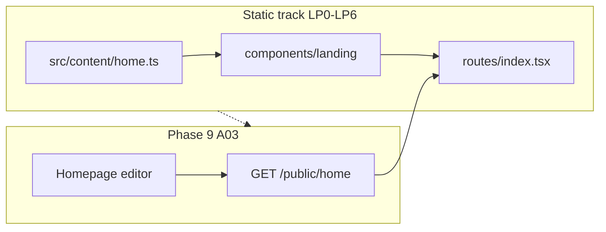

# Landing page (P01) — phased plan (static content)

Phased delivery for a **robust, polished public home** at `/` using **static content in the repo** first. This unblocks design and engineering before [portfolio Phase 9 — A03 CMS homepage editor](../../docs/portfolio-delivery-phases.md) (owner-controlled sections and featured pickers).

**Requirements source:** [P01 — Home](../../AI_ML_Portfolio_Page_by_Page_Content_UX_Requirements.md#p01--home)  
**Visual system:** [design-tokens.md](../../docs/design-tokens.md), [tailwind.md](./tailwind.md), [frontend-developer-guide.md](./frontend-developer-guide.md) §3  
**Current code:** [`src/routes/index.tsx`](../src/routes/index.tsx) (API-driven hero stub + fallbacks), [`src/routes/design-preview.tsx`](../src/routes/design-preview.tsx) (Phase 1 reference compositions, dev-only)

---

## Strategy

| Choice | Rationale |
|--------|-----------|
| **Static content first** | Ship a complete P01-shaped page without waiting for homepage CMS, featured pickers, or publication/project APIs on the home aggregate. |
| **Single content module** | One typed file (e.g. `src/content/home.ts`) — copy from [content-packet](../../docs/content-packet/README.md) when ready; no fabricated metrics. |
| **Presentational sections** | `components/landing/*` — pure props, no `fetch` inside section components. |
| **Defer API home for this track** | Stop relying on `getPublicHome()` for body sections until LP6 or CMS handoff; keep `getPublicSite()` for nav/footer/meta site name if already wired. |
| **Later: CMS parity** | Map static shape → future `GET /public/home` aggregate (Phase 9 / A03) so migration is mostly data, not layout. |



---

## Phase LP0 — Content contract and copy

**Objective:** Lock structure and real (or explicitly approved placeholder) copy — no fake papers, citations, or affiliations.

**Deliverables**

1. **TypeScript model** `HomePageContent` mirroring P01 sections (all optional except hero core):
   - `hero`: name, descriptor, positioning, portrait `{ src, alt } | null`, primary/secondary CTA `{ label, href }`
   - `affiliation`: role, org, location (optional)
   - `researchFocus`: 3–6 items `{ title, description, href }`
   - `selectedPublications`: 2–4 items (title, authorsShort, year, venue, significance, href)
   - `featuredProjects`: 2–3 items (title, summary, tags?, href, image?)
   - `highlights`: verified bullets only (award, talk, milestone — no unsourced counts)
   - `currentlyWorkingOn`: optional `{ text, updatedAt }`
   - `profiles`: `{ label, href }[]` (ORCID, Scholar, GitHub, …)
   - `collaborationCta`: `{ headline, body, href }`
2. **Fill [`docs/content-packet/editorial.md`](../../docs/content-packet/editorial.md)** top-three Home features and tone (researcher sign-off).
3. **Permissions check** — anything public-facing cross-check [content-permissions.md](../../docs/content-permissions.md).

**Exit criteria**

- [ ] `HomePageContent` type reviewed against P01 required sections — see [landing-page-lp0-checklist.md](./landing-page-lp0-checklist.md).
- [ ] Copy is either researcher-approved or labeled `// PLACEHOLDER — replace before launch` in one file only (`src/content/home.content.ts`).
- [ ] No citation/publication counts without source URL + “as of” date.

---

## Phase LP1 — Page shell and section framework

**Checklist:** [landing-page-lp1-checklist.md](./landing-page-lp1-checklist.md)

**Objective:** Scalable layout: one home route, many sections, consistent spacing and headings.

**Deliverables**

1. **`LandingPage` layout wrapper** — `main#main`, vertical rhythm (`gap` / section padding), max-width rules (hero wide, prose sections per tokens).
2. **`LandingSection`** primitive — `id`, `aria-labelledby`, optional `siam-label` kicker, `h2` title, children; supports `hidden` when section data is empty (P01 conditional behavior).
3. **Refactor [`index.tsx`](../src/routes/index.tsx)** — import static `homeContent`, compose sections; wire `@solidjs/meta` `Title` / `description` from static hero + site name (fallback to `getPublicSite()` for site name only if desired).
4. **Remove dev-placeholder hero strings** from production path (keep dev-only `ApiStatus` / design-preview links behind `import.meta.env.DEV`).

**Exit criteria**

- [ ] Single scrollable page with labeled sections and correct heading order (`h1` once in hero).
- [ ] Empty optional sections omitted from DOM (not empty headings).
- [ ] `pnpm typecheck` clean.

---

## Phase LP2 — Hero, affiliation, and primary CTAs

**Checklist:** [landing-page-lp2-checklist.md](./landing-page-lp2-checklist.md) · Hero polish: [landing-page-hero-enhancement.md](./landing-page-hero-enhancement.md)

**Objective:** First screen that passes P01 “identity + next action” test.

**Deliverables**

1. **`HeroBlock`** — typography-led or split layout (copy left; portrait right on `lg+`); mobile: **headline + CTAs before image** (requirements).
2. **Portrait** — `loading="lazy"`, explicit `width`/`height` or aspect ratio to limit CLS; alt required or omit image.
3. **CTAs** — `<A class="siam-btn-primary">` / `siam-btn-secondary`; real `href`s (`/research` or `/#research`, `/contact`, CV URL or `/cv` when exists).
4. **`AffiliationStrip`** — subtle line under hero (role · org · location).

**Design references**

- Reuse patterns from [`design-preview.tsx`](../src/routes/design-preview.tsx) hero; elevate to production quality (not dev-only page).

**Exit criteria**

- [ ] Keyboard: tab order hero → CTAs → next section; focus rings visible.
- [ ] Lighthouse / manual: no layout shift from hero image when used.
- [ ] Meets contrast on canvas/surface per design tokens.

---

## Phase LP3 — Research focus grid

**Checklist:** [landing-page-lp3-checklist.md](./landing-page-lp3-checklist.md)

**Objective:** 3–6 thematic cards linking to future research routes (or `/about#expertise` until Research exists).

**Deliverables**

1. **`ResearchFocusGrid`** — responsive grid (`1` / `2` / `3` cols); card uses `siam-card` + link wrapper or heading link.
2. Short description per theme (1–2 sentences); no hover-only critical text.

**Exit criteria**

- [ ] Each card is a single focusable control or contains a visible link.
- [ ] Section hidden when `researchFocus.length === 0`.

---

## Phase LP4 — Selected publications and featured projects

**Checklist:** [landing-page-lp4-checklist.md](./landing-page-lp4-checklist.md)

**Objective:** Credibility block — curated evidence, not a full P05 list.

**Deliverables**

1. **`PublicationHighlightList`** — reuse or extend `siam-pub-row` from design preview; authors abbreviated, year, venue, one-line significance, link to detail (or `#` stub with `aria-disabled` only in dev — prefer real slugs when Phase 10 exists).
2. **`ProjectCardGrid`** — 2–3 cards: title, problem/outcome summary, optional accent surface (peach/mint per tokens — one accent per card max), link to project detail.
3. **Section headers** — “Selected publications” / “Featured projects” + optional “View all” linking to `/publications` / `/projects` when those routes exist.

**Exit criteria**

- [ ] Publication author order and metadata read correctly on mobile (stacked, no horizontal cram).
- [ ] External links use `ArrowExternal` from `~/icons` where off-site.

---

## Phase LP5 — Highlights, current work, profiles, collaboration CTA

**Checklist:** [landing-page-lp5-checklist.md](./landing-page-lp5-checklist.md)

**Objective:** Close the page with trust and a single collaboration path.

**Deliverables**

1. **`HighlightsList`** — bullets or compact chips; only verified items.
2. **`CurrentlyWorkingOn`** — optional band with “Updated …” date; omit if empty.
3. **`ProfileLinks`** — labeled icon+text or text links row (ORCID, Scholar, GitHub, …).
4. **`CollaborationCta`** — full-width muted band (`surface-muted`), one sentence + Contact CTA.

**Exit criteria**

- [ ] No section displays empty placeholders.
- [ ] Collaboration CTA matches Contact route strategy (static `/contact` or mailto — document choice in content file).

---

## Phase LP6 — Polish, accessibility, and performance

**Checklist:** [landing-page-lp6-checklist.md](./landing-page-lp6-checklist.md)

**Objective:** “Awesome” = restrained motion, tight typography, production meta — not decoration overload.

**Deliverables**

1. **Motion** — optional subtle `opacity`/`translate` on scroll only if `prefers-reduced-motion: no-preference`; otherwise static.
2. **SEO** — `Title`, `Meta description`, Open Graph basics (`og:title`, `og:description`); canonical via existing meta helpers in [`buildPageMeta`](../src/lib/meta/buildPageMeta.ts) if applicable.
3. **A11y pass** — skip link (already in app shell), landmark regions, link text descriptive (“View publication: …” where needed).
4. **Responsive QA** — 320px, 768px, 1280px; sticky header does not cover in-page targets.
5. **Tests** — optional RTL smoke: hero renders name from static content; section count matches non-empty data.
6. **Docs** — short “Static home content” note in [frontend-developer-guide.md](./frontend-developer-guide.md) pointing to `src/content/home.ts`.

**Exit criteria**

- [ ] P01 quality checks from requirements doc satisfied for **static** slice (researcher sign-off).
- [ ] `pnpm build` succeeds; no dev-only strings in production bundle for hero body.
- [ ] Nav/footer still driven by `PublicSiteProvider` / `getPublicSite` where applicable.

---

## Phase LP7 — Handoff to CMS (future, Phase 9)

**Objective:** Replace static import with API without redesigning components.

**Deliverables**

1. Extend API `GET /public/home` aggregate to match `HomePageContent` (or adapter `apiHome → HomePageContent`).
2. `createAsync(() => getPublicHome())` in `index.tsx` with static fallback during migration.
3. A03 admin: section order, show/hide, featured pickers write the same shape.

**Exit criteria**

- [ ] Parity checklist: static page and CMS-driven page render identical for same data snapshot.
- [ ] Portfolio Phase 9 exit criteria for P01/A03 tracked in [portfolio-delivery-phases.md](../../docs/portfolio-delivery-phases.md).

---

## Suggested file layout (implementation)

```
siam-frontend/src/
  content/
    home.ts              # HomePageContent + exported homeContent
  components/
    landing/
      LandingPage.tsx
      LandingSection.tsx
      HeroBlock.tsx
      ResearchFocusGrid.tsx
      PublicationHighlightList.tsx
      ProjectCardGrid.tsx
      HighlightsList.tsx
      ProfileLinks.tsx
      CollaborationCta.tsx
  routes/
    index.tsx            # thin: meta + <LandingPage content={homeContent} />
```

---

## Dependencies and ordering

| Depends on | Notes |
|------------|--------|
| Phase 1 tokens / Nav / Footer | Already present |
| LP0 before LP2–LP5 | Copy drives sections |
| LP1 before LP2–LP5 | Shared shell |
| LP6 after LP2–LP5 | Polish last |
| Phase 10+ routes | “View all” links; detail pages can stub until built |

**Parallel work:** Researcher fills content-packet while LP1–LP2 proceed with approved placeholder copy.

---

## Out of scope for this plan

- Admin homepage editor (A03)
- Dynamic featured pickers from DB
- Global search, contact form backend (separate phases)
- Dark mode (v1 light only per design tokens)

---

## Changelog

| Date | Change |
|------|--------|
| 2026-10-16 | Initial static-first landing phased plan |
