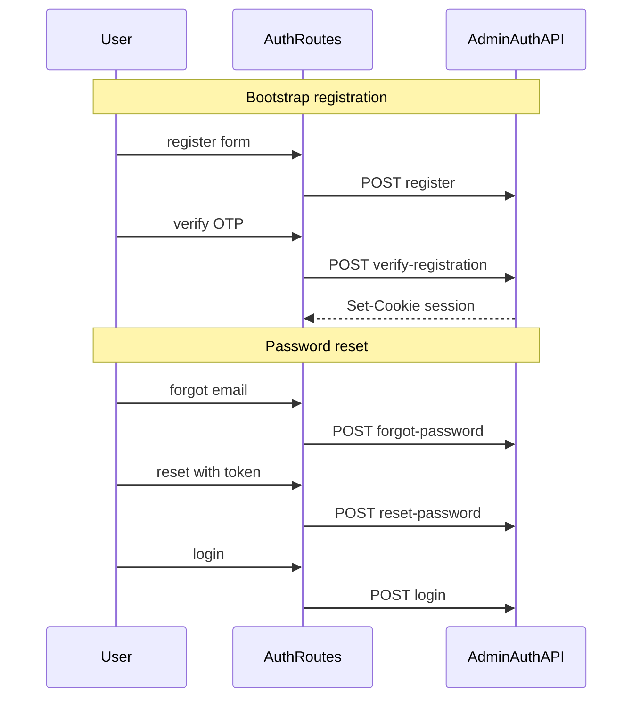

# Admin auth (client)

Session UI and `forceLogout` per [../../docs/frontend-developer-guide.md](../../docs/frontend-developer-guide.md) §5–6.

Server contract: [../../../siam-api/docs/admin-auth.md](../../../siam-api/docs/admin-auth.md).

Route ↔ API map: [../../docs/admin-auth-map.md](../../docs/admin-auth-map.md).

Only **`adminClient`** may trigger `forceLogout` on 401. **`publicClient`** never calls `forceLogout`.

## Flows

## Provider and guard (F5)

[`AdminAuthProvider.tsx`](./AdminAuthProvider.tsx) wraps [`routes/admin.tsx`](../../routes/admin.tsx):

1. `bootstrap()` → `GET /auth/check` (bounded by [`bootstrapWithTimeout.ts`](./bootstrapWithTimeout.ts), 15s) → `authenticated` or `anonymous`
2. While `unknown` (or brief `anonymous` on protected path before redirect) → compact [`PageLoading`](../../components/PageLoading.tsx) **inside** `main#main` with the same main layout classes as the upcoming screen (centered for public auth band; CMS chrome appears only after session resolves)
3. `anonymous` on protected path → `/admin/login?returnUrl=…`
4. `authenticated` on public auth path (except `/admin/reset-password`) → `/admin`

**Post-login `returnUrl`:** guard encodes the current path; login uses [`safeAdminReturnUrl.ts`](./safeAdminReturnUrl.ts) so only `/admin…` paths are honored after sign-in.

**Public auth paths** ([`publicAdminAuthPaths.ts`](./publicAdminAuthPaths.ts)): login, register, register/verify, forgot-password, reset-password.

**Hook:** `useAdminAuth()` → `{ status, admin, bootstrap, setFromLogin, clear }`.

[`adminSession.ts`](./adminSession.ts) bridges to the provider for `forceLogout` and legacy callers.

## `forceLogout`

Called from **`adminClient`** on failed refresh (not from Router context). Uses dynamic `import()` of `adminAuthApi` to avoid a circular module graph with `admin-client.ts`.

1. Best-effort `POST /auth/logout` (`skipAuthHandler`)
2. `adminSession.clear()`
3. `window.location.replace` to `/admin/login?reason=session_expired` and, when the user was on a protected admin path, `returnUrl` (same rules as the layout guard)

Router `navigate` is not used here so logout still works when the 401 handler runs outside Solid Router.

## Forms

Public auth pages use SolidStart **`action`** + **`useSubmission`** (see [`../forms/actions/`](../forms/actions/)). Zod schemas live in [`../forms/schemas/`](../forms/schemas/); actions call `parseWithSchema` then `adminAuthApi`. Errors map through `getAuthFormErrorMessage`.

| Action | `adminAuthApi` | HTTP |
|--------|----------------|------|
| `loginAction` | `login` | `POST /auth/login` |
| `registerAction` | `register` | `POST /auth/register` |
| `verifyRegistrationAction` | `verifyRegistration` | `POST /auth/verify-registration` |
| `forgotPasswordAction` | `forgotPassword` | `POST /auth/forgot-password` |
| `resetPasswordAction` | `resetPassword` | `POST /auth/reset-password` |
| `changePasswordAction` | `changePassword` | `POST /auth/change-password` |

Verify **resend** uses `adminAuthApi.resendRegistrationOtp()` from a button handler (not a form action).

**UI:** [`AdminAuthLayout`](../../components/admin/AdminAuthLayout.tsx) on all public auth routes (`AdminAuthWordmark`, [`AdminAuthFooterLinks`](../../components/admin/AdminAuthFooterLinks.tsx) with contextual links + **Public site**). Authenticated CMS uses [`AdminAppShell`](../../components/admin/AdminAppShell.tsx) (sidebar + full-width layout; mobile drawer) and [`AdminPageHeader`](../../components/admin/AdminPageHeader.tsx) per route. Reference: dev [`/design-preview`](../../routes/(public)/design-preview.tsx) § Admin auth card and Admin workspace shell. Form inputs: [`FormField`](../../components/forms/FormField.tsx) / [`FormTextInput`](../../components/forms/FormTextInput.tsx).
